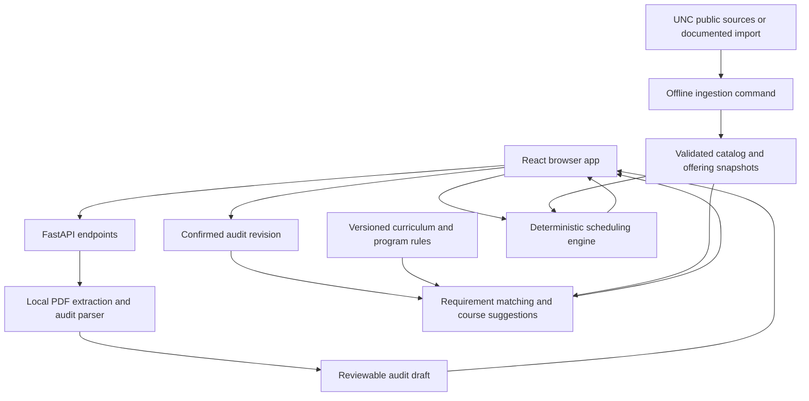

# Proposed architecture

Status: proposal for review, November 6, 2026. This document describes intended behavior, not implemented features.

## 1. Product boundary

A UNC–Chapel Hill student uploads a Tar Heel Tracker PDF, corrects the extracted degree progress, selects courses suggested for outstanding requirements, and compares schedules for one semester. The planner explains suggestions and constraints. It does not enroll students or certify degree completion.

The first usable release supports the two supplied text-based audit layouts, validated curriculum mappings for their catalog years, and a bounded offering dataset. Broader major coverage can expose parsed requirements with manual selection until mappings are verified. Supporting an audit layout does not mean all its policies can be evaluated automatically.

Real course-data ingestion is part of the project. The PDF-to-schedule development sequence can use clearly labeled fixtures while source research and scraping validation proceed. A fixture-backed release and a release with refreshed UNC offerings have separate acceptance gates.

## 2. Curriculum versioning

The central distinction is **starting-year Gen Ed curriculum versus program-specific requirements**. A student's starting year at UNC (entering cohort) determines the applicable Gen Ed curriculum version, represented by the corresponding catalog edition. Freshman, sophomore, and junior are not curriculum versions.

| Dimension | Purpose | Selection |
| --- | --- | --- |
| Gen Ed curriculum family and version | Required Gen Ed categories and counting policies | Starting year/entering cohort, corroborated or identified by the Tracker's Gen Ed requirements and metadata, confirmed in review |
| Degree/program rule version | Major, minor, concentration, and degree requirements | Each program's reported requirement term/version |
| Catalog course edition | Description, credits, attributes, and prerequisites published for an edition | Source edition/effective period |
| Target term offerings | Actual sections and meeting times available for planning | Student's selected semester |
| Parser layout version | How a document's text and structure are interpreted | Detected document structure |

Retain entry term, catalog year, degree, program requirement terms, and transfer/exemption information separately when present. Do not infer unknown values from age, standing, the current calendar year, or the target semester. Conflicting or missing values require review.

Resolve Gen Ed applicability using both explicit starting-year/entry-term metadata and the requirements actually listed in the Tracker. Compare the Gen Ed requirement set against verified version-specific signatures, including distinctive categories and alternatives. A sufficiently distinctive signature can identify a curriculum version when starting-year metadata is absent; record that it was inferred from requirements, with supporting evidence. Do not invent an exact starting year when several cohorts share the same curriculum. Shared labels, incomplete/collapsed sections, or a missing requirement alone are insufficient to distinguish versions. If multiple versions fit, or metadata and requirements conflict, preserve the reported requirements and ask the student to resolve applicability in review. A major's requirement term never selects the Gen Ed version.

Gen Ed definitions are immutable, versioned data files. A new year may reuse reviewed unchanged definitions, but references are explicit and pinned; there is no automatic fallback to the newest year. A display-label change does not prove two requirements have identical rules. Aliases and equivalences must be scoped and verified.

Course attributes are also versioned. A course that carries an attribute today cannot automatically be assumed to have carried it when taken. Matching must reconcile the student's curriculum with the applicable course/section designation and published counting policies. Unverified combinations remain candidate matches requiring confirmation.

Adding a new year means adding a rule pack, source citations, mapping tests, and coverage documentation. Adding the sophomore sample means validating its layout and catalog-year coverage; it does not require a sophomore-specific parser.

## 3. Technology and boundaries

Use a single repository with a React/TypeScript frontend built with Vite and a Python/FastAPI backend. Python owns PDF parsing, rule matching, data import, and scheduling so these operations share one domain model. React handles review forms and the weekly calendar. There is no current requirement for server-rendered pages, a separate Node backend, or Java services.

Use Pydantic for backend contracts, pytest for domain tests, and generated TypeScript API types from FastAPI's OpenAPI schema. Use Vitest/React Testing Library for meaningful frontend behavior and Playwright for the complete upload-to-schedule journey. Exact dependency versions and compatibility are selected and pinned during scaffolding.

Start with pypdf for text extraction: the installed library already extracts text from both supplied samples. First validate reading order, wrapped lines, and evidence placement against the PDFs. Evaluate pdfplumber only if position-aware extraction materially improves failing cases. OCR is deferred until scanned samples justify it. No LLM dependency is proposed.

Use validated JSON snapshots for public course/section data and JSON rule packs for curricula. No student database is needed initially. Add SQLite only if query volume or public-data management makes files cumbersome; account storage and PostgreSQL are later decisions.



The diagram shows logical modules, not separate services. Scraping is an offline command initially, not work performed for every student upload. One backend process and one frontend are sufficient for development.

Proposed structure:

```text
frontend/src/
  api/                   generated contracts and API client
  features/
    upload/ review/ recommendations/ planning/ results/
  components/            reusable form and calendar components
backend/
  app/
    api/                 request validation and endpoint adapters
    domain/              shared models and invariants
    audit/               extraction, layout adapters, normalization
    curriculum/          rule loading and applicability
    recommendations/     explainable candidate matching
    scheduling/          bundles, search, scoring, diagnostics
    ingestion/           source adapters, validation, snapshot publishing
  tests/                 unit, fixture, and integration tests
data/
  curricula/             public, versioned Gen Ed rule packs
  programs/              verified program mappings
  samples/               clearly fictional course and section fixtures
  schemas/               documented import schemas
docs/
```

## 4. Domain model

Names below are proposed contracts. Public identifiers should be stable and source-backed; document-local identifiers must remain distinct from catalog rule IDs until matched.

| Model | Essential fields and invariants |
| --- | --- |
| `SourceSnapshot` | ID, source URL, retrieved timestamp, effective period, source edition, content hash, adapter/schema versions, validation state; public or fictional classification |
| `CurriculumVersion` | ID, family, applicable catalog year, source references, rule revision, support state |
| `ProgramVersion` | Program/degree/concentration ID, applicable requirement term, rule revision and sources |
| `RequirementDefinition` | Versioned ID, kind, children/operator, qualifying course IDs or attribute selectors, thresholds, counting restrictions, applicability, source references |
| `Course` / `CourseEdition` | Stable course ID plus edition-specific title, credits/range, description, raw prerequisite/corequisite text and sourced designations |
| `CourseDesignation` | Course or section ID, attribute ID, effective period/source edition, evidence; no timeless attribute array |
| `Term` | Source ID, display name, campus timezone, dates when known; never fabricate UNC term codes |
| `Section` | Term-scoped ID, course ID, section number, components, modality, meetings, credits/credit policy, instructor/location when supplied, provenance |
| `Meeting` | Weekday, local start/end minutes, applicable dates, type; distinguish timed, asynchronous, arranged, and unknown |
| `SectionBundle` | Valid section/component IDs for a course selection, computed credit contribution and validated linkage |
| `AuditDraft` | Schema/parser versions, starting year/entry term when known, reported catalog year, resolved Gen Ed version with selection method/evidence and candidate versions, independent program terms, attempts, requirement tree, extraction issues, review state |
| `CourseAttempt` | Course ID when recognized, term, grade, credits, completed/in-progress/unknown status, transfer/exam origin, evidence |
| `AuditRequirement` | Local ID, parent, original label and status, normalized status, needed amounts, contributing attempts, matched rule ID if verified, evidence and issues |
| `ReviewedAudit` | Confirmed revision, edits, unresolved items and applicability selections; distinct from the original draft |
| `CourseSuggestion` | Course ID, requirement links, mapping evidence, eligibility state, offering availability and unresolved conditions |
| `PlanRequest` | Reviewed audit revision, snapshot IDs, course selections, required/optional flags, credit and meeting constraints, soft preferences |
| `ScheduleResult` | Bundles, total credits, score breakdown, warnings, dataset/rule versions, search-completeness metadata |

Requirements need a small typed vocabulary: direct course, all-of, any-of, course-count, credit-pool, attribute-based category, policy, non-course milestone, and unsupported. Minimum grade, residency, exclusions, and reuse limits are typed constraints where supported; otherwise preserve their text and mark them for review. Do not build a universal degree-audit language in the first release.

Keep the audit's reported status (`satisfied`, `not_satisfied`, `unknown`) separate from completion evidence (`completed`, `in_progress`, `mixed`, `unknown`). An audit can report satisfied using in-progress work. Flag that condition without overriding the audit or declaring final completion.

Do not merge all appearances of a course into one attempt: repeated attempts in different terms are legitimate. Deduplicate repeated references within audit requirement blocks while retaining their links. Keep transfer/exam records distinct until equivalence is established.

## 5. PDF extraction and review

Pipeline:

1. Validate PDF signature, configured size/page limits, encryption and readability; extract within resource/time limits.
2. Extract per-page text with line/block positions when available. Do not rely on fixed line numbers or name/PID slicing.
3. Detect supported structural markers; retain page boundaries, join verified continuation lines, and remove repeated page furniture.
4. Read catalog/program metadata, requirement hierarchy, course tables, grades, term values, and explicit status markers through independently tested parser functions.
5. Normalize recognized items; retain original evidence and diagnostic codes for ambiguity. Unsupported sections stay visible.
6. Return a draft with page/line evidence and reasoned states such as `recognized` or `needs_review`; avoid invented probability scores.
7. Let the student correct metadata, course attempts, statuses, candidate mappings, and unsupported items, then confirm a revision.

The review UI groups issues by consequence. Missing curriculum selection blocks curriculum-based automatic suggestions; an unresolved non-course milestone can remain visible without blocking unrelated course planning. A raw-text fallback can assist correction, but never silently reports a failed parser as successful.

The reviewed Tracker is the starting point for remaining requirements. The app initially explains and matches those requirements rather than independently recomputing the student's entire degree. If published rules and the audit disagree, surface the disagreement for review. A new suggested course produces a potential contribution, not a certified updated audit.

## 6. Course-data collection

Three source adapters feed common schemas: catalog/course designations, curriculum/program rules, and term-specific sections. A fourth path imports documented JSON/CSV data. Sources, unresolved access questions, and validation tasks are in [DATA_SOURCES.md](DATA_SOURCES.md).

Ingestion sequence: fetch permitted public content → retain public-source snapshot and provenance → extract → normalize → validate → produce a diff against the previous snapshot → publish atomically. A failed or partial scrape must not overwrite a validated dataset. A source omission cannot automatically delete courses unless the run is known to be complete.

Validate duplicate IDs, referential integrity, credit values, day/time/date ranges, section links, term consistency, attribute labels, and unknown values. Verify representative records against the rendered source before declaring an adapter usable. Never infer lecture/lab pairings from section-number conventions alone.

Cache, rate-limit and retry conservatively. Check source access conditions before implementing collection. Public visibility alone does not establish permission to automate collection. A public browser interface is not proof of a supported API. No UNC credentials are collected. No refresh interval is promised until source constraints are established.

## 7. Requirement matching and recommendations

Start from reviewed unmet requirements. Resolve the applicable Gen Ed rule pack independently from program mappings. Match direct course requirements first, then verified alternative sets and attribute-based categories. Unsupported elective/policy text stays available for manual selection.

Filter or annotate candidates based on completed/repeated coursework, current enrollments, verified prerequisites, and target-term offerings. Free-form prerequisite text is displayed for verification until structured rules exist. In-progress prerequisites can be marked conditional for a later term; they are not proof of completion. Unknown eligibility must never be labeled eligible.

Each suggestion explains which requirement it could address, why the mapping applies to the student's catalog year, and what remains uncertain. Distinguish a catalog candidate from an actually offered course. A candidate with no target-term offering can remain informational but cannot generate a schedule bundle.

A course may be a candidate for multiple requirements without being allowed to satisfy all of them simultaneously. Apply verified counting restrictions when calculating combined benefit. If those restrictions are unimplemented or unknown, show possible matches without claiming cumulative credit or optimizing a graduation path. Non-course requirements such as events never become fabricated courses.

Keep course-suggestion ranking separate from schedule ranking. Initial suggestion order is deterministic and transparent: verified matches and target-term availability, followed by stable course-code ordering. Defer advanced progress-maximizing course-set optimization.

## 8. Scheduling engine

Input is an explicit student-selected course set with required/optional flags. The engine selects sections; it does not implicitly choose from every catalog course. Students choose candidates from suggestions before invoking it.

1. Validate terms, immutable snapshot references, credit preferences and selections.
2. Build valid section bundles from verified component relationships. Reject incomplete required components.
3. Filter bundles against hard day/time constraints; exclude unknown/arranged-time sections from the initial conflict-free results. Display their exclusion and permit manual planning separately. True asynchronous sections have no fixed meetings.
4. Search deterministically, starting with required courses and the fewest valid bundles. Include skip branches for optional courses.
5. Prune on conflicts, credit maxima, and unattainable credit minima. Count a section's credit contribution once; do not duplicate lecture credits through components. A separately credit-bearing lab course retains its own credits.
6. Rank feasible schedules using centralized documented weights for credit-target distance, preferred time of day, gaps, and compact campus days. Break ties using sorted section IDs.
7. Deduplicate and return a bounded top set with score explanations and diagnostics.

Compare timed intervals only on common weekdays and overlapping applicable dates: `startA < endB && startB < endA`. Adjacent classes are allowed. When dates are absent use the term range if known, otherwise conservatively assume shared dates. Render in `America/New_York`, using local wall-clock meeting times and term dates for later calendar exports.

Variable-credit selections must resolve to a valid chosen credit value before search. Cross-listed equivalent sections must not be selected twice. Explicit recurring unavailable-time blocks can be added after the core day/time constraints.

Bound work using a configurable deterministic node budget as well as operational request limits. A top-N heap bounds stored results, not search cost. Report `search_complete=false` when stopped; never claim global top-N or impossibility from an incomplete search. Diagnostic levels distinguish proven input impossibility, detected conflicts, and exhausted search budget. Never relax a hard constraint silently.

## 9. Frontend and API

Screens: upload, degree-progress review, course suggestions/search, plan preferences, and results with weekly calendar and accessible list view. Provide loading, empty, unsupported PDF, unavailable data, validation, and no-results states. Data provenance and sample labels accompany relevant results. The student can backtrack; editing an audit invalidates dependent suggestions and editing a plan invalidates generated schedules.

Proposed `/api/v1` contracts:

| Endpoint | Responsibility |
| --- | --- |
| `POST /audits/parse` | Multipart PDF → draft and diagnostic evidence |
| `POST /audits/review` | Draft plus corrections → validated confirmed revision |
| `GET /curricula` | Supported Gen Ed/program versions and coverage |
| `GET /terms` | Available target-term snapshots with freshness and source |
| `GET /courses` | Validated search/filter, pagination, optional term/attribute filters |
| `GET /courses/{course_id}/sections` | Offering details for an explicit term/snapshot |
| `POST /recommendations` | Reviewed progress plus versions → explained candidate matches |
| `POST /schedules/generate` | Explicit selections and constraints → results and diagnostics |

The initial backend is stateless for student data: each operation receives necessary normalized state from the browser, validates it again, and returns a result. Revision checks prevent accidental stale combinations; they are not identity or authenticity guarantees. Only catalog/section/rule data reside on the server between requests. Administrative ingestion is a CLI command, not a publicly exposed write endpoint.

Keep student state in browser memory by default. Refreshing loses the session; say so before upload. Explicit preferred-schedule JSON and ICS downloads are available; JSON contains a schedule record without the reviewed audit and cannot yet restore a session. Export revalidates generation inputs and selected sections against snapshot/rule versions. See CALENDAR_AND_EXPORT.md. Do not put audits in URLs, analytics, default local storage, or error telemetry. Define endpoint schemas centrally and return structured errors with issue codes, field paths and safe messages.

## 10. Privacy, operations, and deployment

Discard upload bytes and intermediate student evidence after the request; if a library spills to temporary files, guarantee cleanup on success, exceptions, and cancellation. Configure upload, parser, request and response size limits. Do not retain names or PIDs in the domain model. Evidence visible to a student should omit irrelevant identifying headers; test this explicitly.

Exclude private PDFs, extracted text, local environments, caches, and private snapshots from version control. Create committed redacted/synthetic fixtures that preserve relevant layout and edge cases; keep any authorized originals local. Validate meaningful redaction rather than masking visible text while leaving the underlying PDF text intact.

Record request duration, error codes, parser/rule versions and public dataset IDs; omit filenames, document text and student records. Public deployment needs HTTPS, restricted CORS, request/rate limits, safe errors and resource-limited PDF processing. Keep this as one application deployment; add job queues only if observed processing time requires asynchronous jobs.

Build the frontend as static assets and serve it with the backend or a static host that proxies `/api`; no hosting provider is selected yet. Start ingestion manually, then schedule it only after refresh policy validation. CI runs backend tests, frontend checks/build, and an end-to-end fixture workflow. Document exact setup and launch commands once the scaffold exists.

## 11. Extension boundaries and unresolved decisions

Add new Gen Ed years through rule packs and tests; new PDF layouts through extraction adapters; new UNC sources through ingestion adapters. Keep these extension points independent. Supporting older curriculum families may need additional mappings but must not change the scheduling engine.

Initial proposals: no accounts, no persistent student data, two representative audit layouts, catalog-year Gen Ed coverage first, conservative major mappings, deterministic scheduling, and one target-term dataset. Program-wide audit recomputation, OCR, LLM parsing, seat monitoring, multi-semester optimization, and registration remain later work.

Decisions requiring product review and external validation are tracked in the implementation plan. Unknown source access or missing samples limit coverage; they should not block independent implementation work.
