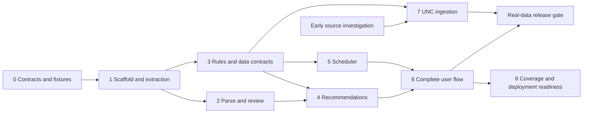

# Implementation plan for review

Status: milestones 1–5 are implemented within documented partial coverage, including preferences and deterministic section scheduling. See [SCHEDULING.md](SCHEDULING.md) and [RECOMMENDATIONS.md](RECOMMENDATIONS.md) for limits. Milestone 6 calendar comparison/export onward remains planned. Parser and rule coverage remain in [SAMPLE_COVERAGE.md](SAMPLE_COVERAGE.md) and [CURRICULUM_RULES.md](CURRICULUM_RULES.md). The owner deferred review-UX redesign; retain [the follow-up note](REVIEW_UX_IDEAS.md). Review alongside [ARCHITECTURE.md](ARCHITECTURE.md), [DATA_SOURCES.md](DATA_SOURCES.md), and [implementation status](IMPLEMENTATION_STATUS.md).

## Release targets

**First usable release:** a supported Tracker PDF can be uploaded, reviewed, mapped to explained course candidates, and used to generate valid schedules against an explicitly labeled fixture/imported dataset.

**UNC-data release:** the same flow works against a validated, source-attributed UNC target-term snapshot and verified catalog-year Gen Ed mappings. Scraping is a planned workstream; release readiness depends on validated sources, not assumptions about APIs.

Neither target requires accounts, real-time seat tracking, registration, or a complete replacement for UNC's degree-audit system.

## Decisions proposed for review

| Decision | Proposed default | Consequence |
| --- | --- | --- |
| Stack | React + TypeScript/Vite; Python/FastAPI | Two languages, one backend for parsing, matching and scheduling |
| Curriculum identity | Gen Ed version follows starting year/entering cohort; identify or corroborate it using Tracker requirements and metadata; programs versioned independently | Preserve selection evidence and ambiguity; no class-standing-specific logic |
| First parser coverage | Both supplied text-based PDF layouts | New layouts remain visibly unsupported until validated |
| First Gen Ed coverage | Partial sourced 2024–2025, 2025–2026 and 2026–2027 packs | 2025 archive verified early; sophomore PDF still strengthens parser-layout coverage when available |
| Major/minor scope | Extract all readable requirement text; automatically match only verified direct courses/alternatives initially | Broad review support without pretending every program policy is modeled |
| First offering dataset | One target term; fictional fixtures for early development | Choose actual term after source availability is validated |
| Storage | Public JSON snapshots; student state in browser memory | No accounts; reload loses unsaved state |
| Scraping | Investigate early, implement behind stable import contracts | Source issues do not stall parser/solver development |
| Unknown meeting times | Excluded from conflict-free generated results | Student sees exclusions and can plan those courses manually |
| Save/export | Plan JSON and ICS after core flow | No persistent cloud student database required |

These are reviewable defaults, not requests to resolve every detail before any coding. The most consequential product choices are initial program breadth, which real target semester to support, and whether cross-session saving is needed for the first release.

## Milestone 0 — Finalize contracts and sample expectations

Dependencies: architecture review.

Deliverables:

- Record accepted decisions and supported/deferred scope.
- Build a local sample coverage checklist from the freshman and junior trackers without retaining names/PIDs in documentation.
- Establish expected metadata, course attempts, requirement boundaries and uncertain cases through manual comparison with each PDF.
- Create safely redacted or synthetic regression fixtures preserving relevant page structure and wrapped rows. Keep authorized originals local and outside committed fixtures.
- Define initial JSON contract examples for audit, rule pack, course, section, recommendation and schedule request/result, including schema versions.

Acceptance: expected outputs can be reviewed before implementing parser behavior; a new catalog year, program version, and parser layout have distinct identifiers. No original student PDF or extracted personal data is committed.

## Milestone 1 — Scaffold and extraction foundation

Dependencies: milestone 0.

Deliverables:

- Create frontend/backend structure, dependency manifests/lock files, setup instructions, and version-control exclusions. Replace the disposable parser experiment; do not delete the local PDF or virtual environment as collateral cleanup.
- Add FastAPI health endpoint, shared domain models, structured errors and generated frontend API contracts.
- Build the upload screen and PDF extraction endpoint with size/page/time limits and guaranteed temporary-file cleanup.
- Return a reviewable extraction result with page evidence, explicit support state, and parser issues; do not advertise semantic parsing before milestone 2.
- Validate pypdf reading order on both samples; record whether positional tooling is needed.

Acceptance: a local browser uploads a supported redacted PDF and receives readable per-page extraction; invalid, encrypted/unreadable and empty/scanned PDFs receive useful errors. Tests verify cleanup and absence of sensitive log output. README contains actual launch commands.

Verification: backend extraction/integration tests, frontend typecheck/build, and upload-state behavior tests. No fabricated course suggestions.

## Milestone 2 — Structured parsing and student review

Dependencies: milestone 1; sample expectations from milestone 0.

Deliverables:

- Extract starting year/entry term when present, reported catalog year, independent degree/program requirement terms, completed/in-progress/unknown attempts, requirement hierarchy and statuses.
- Preserve the Gen Ed requirement set as evidence for version identification; distinguish reported metadata from inferred curriculum applicability.
- Parse by section markers and course-table context; handle page continuations, wrapped titles, repeated course references and status prefixes conservatively.
- Preserve satisfied-with-in-progress distinctions, raw evidence and unsupported policy/non-course items.
- Implement review/edit controls for metadata, attempts and requirements; add/edit/remove and explicit confirmation with revision tracking.
- Document supported patterns and unresolved extraction cases. Correcting a confirmed audit invalidates dependent results.

Acceptance: both representative samples produce manually checked expected fields; every ambiguous supported sample item is either correctly parsed or flagged. A student can correct an error and continue. Missing starting-year/catalog metadata never defaults to the latest curriculum; a distinctive verified requirement signature can identify a version without fabricating the starting year. Unsupported requirements remain visible.

Verification: fixture expectations for both samples; edge cases for repeated attempts, transfer/exam entries, course-code suffixes, missing grades, section continuations and contradictory metadata. UI tests verify corrections and review gating.

## Milestone 3 — Versioned curricula and course-data contracts

Dependencies: domain contracts from milestone 1; can begin while milestone 2 is in progress.

Deliverables:

- Implement Gen Ed and independent program rule-pack schemas, applicability selection and loaders. Resolve Gen Ed by starting cohort and verified Tracker requirement signatures; retain selection method, evidence, competing versions and conflicts for review.
- Verify the two sample catalog-year packs against published/archived sources; document unsupported clauses and source links. Never infer full policies just from PDF labels.
- Implement course/course-edition/designation, term, section, meeting and component schemas and JSON import validation.
- Create 8–12 clearly fictional courses with multiple sections, including conflicts, linked components, separate credit-bearing labs, unknown times, asynchronous meetings and unavailable options.
- Add source/snapshot metadata and immutable dataset selection. Offer a CLI import/validation report.

Acceptance: the same course can have different edition-specific designations; two students with different catalog years receive their own Gen Ed definitions independently of their major. Missing rule packs give explicit coverage warnings. Invalid imports fail without corrupting published data.

Verification: schema validation, starting-cohort curriculum selection, requirement-based identification with missing metadata, multiple cohorts sharing one version, incomplete/ambiguous requirement sets, conflicting metadata/signatures, independent major terms, no implicit newest-year fallback, referential integrity, malformed meetings, duplicate records and component-credit cases.

## Milestone 4 — Requirement-driven recommendations and selection

Dependencies: milestones 2 and 3.

Deliverables:

- Implement direct course, verified alternative-set and verified Gen Ed attribute matching.
- Explain matches with catalog/program version, evidence, applicable restrictions and offering availability.
- Handle elective pools, unmet credit counts, policy-only items and non-course milestones with explicit manual-review paths.
- Flag prerequisite uncertainty, distinguish in-progress from completed attempts, and avoid automatically suggesting completed nonrepeatable courses.
- Build searchable suggestion cards and a selectable course list with required/optional flags.

Acceptance: changing only catalog year can change Gen Ed suggestions without changing the major rules. Unsupported mappings never claim fulfillment. A course with multiple possible matches does not receive unsupported cumulative benefit. No-offering candidates cannot masquerade as schedulable selections.

Verification: positive/negative mapping cases for both catalog years; manual overrides; missing data; completed courses; conditional prerequisites; non-course items; counting-policy restrictions and stale review revisions.

## Milestone 5 — Deterministic schedule generation

Dependencies: milestone 3 contracts; milestone 4 provides the final UI integration.

Deliverables:

- Implement section bundles and credit contributions, term/date-aware conflict checks and hard-constraint filtering.
- Implement deterministic backtracking with optional-course skip branches, pruning, deduplication, centralized scoring and stable tie-breaking.
- Return bounded results with score explanations and specific no-results diagnostics where provable.
- Enforce node/request budgets and return search-completeness metadata; separate no proven solution from no solution found before a limit.

Acceptance: every returned schedule satisfies hard constraints and valid component links; credit totals are correct. Identical requests/snapshots produce identical complete-search results. Incomplete searches do not claim global optimality or infeasibility.

Verification: overlap/adjacency, weekday/date overlap, lecture/lab links, independent lab credit, variable credits, required/optional selections, impossible credit ranges, excluded days, asynchronous/unknown meetings, cross-list duplicates, deterministic ranking and budget exhaustion. Compare small exhaustive cases against an independent brute-force oracle.

## Milestone 6 — Complete PDF-to-schedule experience

Dependencies: milestones 2–5.

Status: calendar comparison, preferred selection, print and JSON/ICS exports are implemented with targeted Chromium checks; see [handoff](IMPLEMENTATION_STATUS.md) and [calendar behavior](CALENDAR_AND_EXPORT.md). The owner explicitly deferred confirmation UX redesign. Full release acceptance still requires owner usability review; original junior sample planning uses manual sample-course selection because its remaining mapped coursework needs no new suggested class.

Deliverables:

- Revisit the working review/confirmation experience with the owner using [review UX ideas](REVIEW_UX_IDEAS.md); the current design is explicitly provisional.
- Connect upload → review → suggestions → selections/preferences → generated schedules.
- Build weekly calendar, accessible list view, comparison cards, section details and visible preference explanations.
- Handle loading, unavailable datasets, unsupported requirements, empty suggestions, generation failures and no feasible results.
- Support returning to earlier steps with explicit invalidation of dependent output. Include data source/freshness and fictional-data labels throughout.
- Add optional print view, followed by plan JSON/ICS export if core acceptance is stable.

Acceptance: the complete flow works from both representative PDFs with corrections and sample/imported offerings. There is no requirement to complete planning through a manual-only path. Keyboard navigation and non-color course identification work.

Verification: Playwright end-to-end scenarios for both samples, correction followed by regeneration, impossible plan feedback, viewport checks and targeted accessibility checks. Exports, if included, preserve selected sections, dates and timezone.

Release gate: first usable fixture/import-backed release. It must be labeled accurately; this is not the UNC-data release.

## Milestone 7 — Validated UNC ingestion and real-term release

Dependencies: source investigation may start after architecture review; production ingestion depends on milestone 3 contracts. Final release depends on milestone 6.

Status: first subject adapters implemented and live COMP catalog / Spring 2027 section responses validated, with offline replay, strict field/count checks and explicit import diffs. See [source findings and remaining gaps](UNC_INGESTION.md). Outputs are staged only; missing component links and honors catalog identities prevent the real-term scheduling release.

Deliverables:

- Complete the source validation checklist in DATA_SOURCES.md; record access conditions, interface status and field coverage.
- Implement permitted catalog/designation and term-section adapters separately, plus archived curriculum capture where practical.
- Normalize source term/section identifiers and verified meeting/linkage rules; retain unresolved fields rather than inventing values.
- Add caching, retries, completeness checks, import diffs and atomic publication. Keep old validated snapshots when a refresh fails.
- Manually reconcile representative imported records against UNC source displays; choose one actual target semester and document refresh policy.
- Verify source-attributed curriculum mappings independently of course/section scraping.

Acceptance: a real-data plan references validated public records and its source/retrieval time. Courses unavailable in the selected term do not enter generated schedules. Missing component relationships or meeting times restrict coverage explicitly. No real-time seat guarantee is made.

Verification: stored public HTML/response fixtures, selector/schema-change failures, pagination and completeness tests, removed/changed sections, rate-limit failures, source outages and previous-snapshot retention. Perform a manual real-term end-to-end check.

If reliable permitted access fails: document the precise gap and keep import support. The UNC-data release remains blocked for the affected coverage; the fixture/import-backed release can remain usable.

## Milestone 8 — Coverage expansion and deployment readiness

Dependencies: a stable core flow. Public deployment requires the operational checks even if coverage expansion is deferred.

Deliverables:

- Extend the partial 2025–2026 rule pack and validate the sophomore tracker when supplied; its initial archive-backed definitions were added in milestone 3.
- Add broader program, transfer, exception and older-curriculum coverage only with representative evidence and regression cases.
- Test hosting configuration, HTTPS/proxy behavior, CORS, upload limits, safe telemetry, resource isolation, request limits and dependency updates.
- Profile realistic course-selection sizes; document supported limits and tune solver budgets from measurements.
- Establish CI, release smoke tests, public-data refresh/rollback instructions, support matrix and troubleshooting documentation.

Acceptance: adding a supported year changes data/mappings and tests rather than the solver. Public release has reproducible setup, declared coverage and known limitations, no retained student uploads, and a tested failed-refresh recovery path.

Later scope: optional local save/export enhancements, accounts if demanded, more complex prerequisite logic, OCR with real samples, multi-semester optimization, and supported availability monitoring. These are separate review decisions.

## Dependency map and delivery discipline

Implement small reviewable increments. At each milestone, report files changed, actual verification results, support coverage and remaining assumptions. Do not declare milestones complete because scaffolding exists. Update this plan as decisions change.

No calendar estimate is asserted before the parser fixtures and UNC source validation establish the uncertain work. Use milestone acceptance gates to measure progress; estimate effort after those discovery steps.
